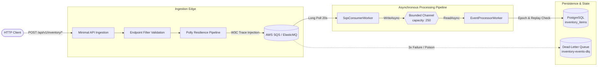

# Event Ingestion Pipeline: Reference Implementation

A production-grade, event-driven inventory ingestion engine built on **.NET 10**, **C# 13**, and **PostgreSQL**. Demonstrates asynchronous decoupling, bounded backpressure pipelines, distributed tracing context propagation, entity-level ring-buffer idempotency, and ephemeral containerized integration testing without commercial dependencies.

### Motivation & Problem Context

Stateful, high-throughput ingestion pipelines—common in travel, hospitality, reservations, and supply chains—must preserve correct state despite asynchronous delivery and retries:

1. **Out-of-order updates**: Strict FIFO processing across distributed consumers can constrain horizontal scaling. Relative adjustments that arrive after a newer absolute snapshot must not overwrite the newer baseline.
2. **Replays and retries**: Network failures, consumer restarts, and visibility-timeout expirations cause messages to be delivered more than once. Dedicated deduplication tables can add unbounded growth, index maintenance, and contention to hot write paths.
3. **Infrastructure fidelity**: Lightweight in-memory substitutes can miss relational transaction and concurrency behavior, native PostgreSQL type handling, or broker visibility and redrive semantics.

This repository demonstrates one way to address these operational concerns with modern .NET primitives and open-source infrastructure:

* **Snapshot epoch gating** rejects deltas older than the current snapshot; optimistic concurrency protects competing updates.
* **Entity-level idempotency** stores a bounded recent-event ring buffer in a PostgreSQL `text[]` column, avoiding an auxiliary deduplication table.
* **Bounded channels and renewable SQS visibility leases** provide backpressure while keeping received messages owned during queued and in-flight work.
* **Testcontainers-backed integration tests** exercise PostgreSQL persistence and concurrency alongside ElasticMQ queue, visibility, and dead-letter behavior using real containers.

---

### Architectural Overview

The service ingests high-frequency inventory events (absolute snapshots and relative deltas) through an asynchronous decoupling boundary, enforcing strict idempotency and baseline epoching before persisting state.



#### Request Flow
1. **HTTP Ingestion**: An HTTP POST arrives at `/api/v1/inventory/snapshot` or `/api/v1/inventory/delta`.
2. **Resilience & Dispatch**: Payloads pass endpoint validation filters and are dispatched via `SqsEventPublisher` using a Polly exponential retry/jitter pipeline. The active W3C `traceparent` and `tracestate` headers are injected directly into the SQS message attributes. The API returns `202 Accepted` immediately.
3. **Consumer Decoupling**: `SqsConsumerWorker` polls SQS via long-polling (20s) and writes incoming messages into an internal `System.Threading.Channels.Channel<InventoryEventEnvelope>` configured with a bounded capacity of 250 items and `BoundedChannelFullMode.Wait`.
4. **Processing & Persistence**: One `EventProcessorWorker` per application instance reads from the channel, reconstructs the distributed trace via `ActivitySource`, evaluates idempotency and snapshot epoch constraints, and updates `InventoryDbContext`. Multiple application instances can consume the same queue; optimistic concurrency protects conflicting writes across instances.
5. **Acknowledgment & Redrive**: SQS messages are deleted only after successful processing and any required database commit. Unsupported event types, null or malformed payloads, and processing failures are logged and left unacknowledged; after 3 failed receive attempts, the message routes to `inventory-events-dlq`.

**Visibility leases**: The consumer requests `Sqs:VisibilityTimeoutSeconds` (default: 60, supported range: 3-43200) and renews each received message every third of that interval, including time blocked on channel capacity. Renewal requests have a one-interval timeout. A renewal failure is logged and cancels that message's processing attempt without acknowledgment; any already committed event remains protected by the idempotency checks on redelivery.

**Shutdown**: Hosted services stop sequentially in reverse registration order. The poller cancels long-polling, finishes transferring its received batch, and completes the channel writer. The processor then drains the channel while visibility leases continue renewing. If `HostOptions.ShutdownTimeout` (30 seconds by default) expires, blocked writes and unfinished database operations are cancelled; unacknowledged messages become available again after their visibility timeout. The deployment's termination grace period must allow this shutdown budget plus host cleanup.

---

### Architectural Decisions & Trade-Offs

#### 1. Entity-Level Ring-Buffer Idempotency vs. Outbox / Deduplication Tables
* **Decision**: Store recent message identifiers directly on the `inventory_items` table in a native PostgreSQL `text[]` column (`RecentEventIds`), capped at a fixed ring-buffer capacity (20 entries).
* **Rationale**: High-throughput delta streams frequently deliver duplicate messages during network retries or consumer restarts. Traditional deduplication tables introduce unbounded row growth, table bloat, and costly secondary index lookups on hot write paths. Embedding a fixed-capacity ring buffer within the entity row eliminates join overhead and ensures state updates and deduplication metadata persist within a single atomic write.
* **Trade-Off**: A ring buffer protects against near-term retries and replays. Replays arriving after 20 subsequent operations fall back on baseline epoch gating.
* **Concurrency**: PostgreSQL's `xmin` row version detects concurrent writes. Conflicting updates and inventory primary-key insert races are retried with a fresh context; provider-specific conflict classification stays in the persistence layer.
* **Audit timestamps**: Tracked `InventoryDbContext` saves set `CreatedAtUtc` and `LastUpdatedUtc` to the same UTC persistence-time value on insertion, regardless of producer timestamps. Updates preserve creation time and refresh only the changed rows' `LastUpdatedUtc`; ignored replays, stale events, and no-op saves leave audit metadata unchanged. Both synchronous and asynchronous saves use the same `TimeProvider`-backed policy. Direct SQL/bulk operations bypass this context-level policy.

#### 2. Snapshot Epoch Gating
* **Decision**: Maintain a `LastSnapshotUtc` timestamp on every inventory row. Any inbound delta with a `Timestamp` older than the entity's `LastSnapshotUtc` is discarded as obsolete.
* **Rationale**: Out-of-order message delivery is guaranteed in distributed queues without strict single-consumer FIFO partitions. Delta updates that predate an absolute snapshot baseline are chronologically invalid and must not mutate current availability.

#### 3. Bounded In-Memory Channel vs. Direct In-Memory Handlers
* **Decision**: Separate the SQS retrieval loop from database writes via a bounded `System.Threading.Channels` pipeline.
* **Rationale**: Decouples the network I/O of SQS batch retrieval from EF Core transaction execution. Bounding the channel to 250 items applies natural backpressure to the consumer loop, preventing out-of-memory errors during downstream database latency spikes while maintaining graceful drain semantics during SIGTERM shutdowns.
* **Configuration**: `Channel:Capacity` defaults to 250 and is also 250 in development configuration. It must be positive and can be overridden with `Channel__Capacity`. The single processor per instance is intentional. Throughput scales horizontally by increasing container/pod replicas rather than adding in-process processing threads. Tune capacity and replica count using load measurements.

#### 4. Zero-Mock Testing via Testcontainers
* **Decision**: Use ephemeral PostgreSQL instances orchestrated by `Testcontainers.PostgreSql` for relational integration verification.
* **Rationale**: In-memory database providers do not support native PostgreSQL types (such as `text[]` arrays) or transactional concurrency semantics. Testcontainers runs real migrations against an isolated engine, validating native behaviors in an environment identical to production.

---

### Component Topology

```text
event-ingestion-pipeline-reference-impl/
├── compose.json                        # Shared development infrastructure & image references
├── docker/
│   └── elasticmq/
│       └── elasticmq.conf               # Declarative SQS queue & DLQ redrive topology
├── src/
│   └── Api/
│       ├── Domain/
│       │   ├── Entities/                # InventoryItem with bounded ring-buffer
│       │   └── Events/                  # Immutable record definitions (Snapshot, Delta)
│       ├── Endpoints/                   # Route groups & endpoint filter validation
│       ├── Infrastructure/
│       │   ├── SqsEventPublisher.cs     # Polly resilience & trace propagation
│       │   ├── HealthChecks/
│       │   │   ├── PostgresHealthCheck.cs
│       │   │   └── SqsHealthCheck.cs
│       │   ├── Queue/
│       │   │   └── SqsVisibilityLease.cs # Broker message ownership renewal
│       │   └── Persistence/
│       │       ├── InventoryDbContext.cs
│       │       └── PostgresInventoryConflictClassifier.cs
│       └── Workers/
│           ├── SqsConsumerWorker.cs     # BackgroundService for SQS polling & channel feeding
│           └── EventProcessorWorker.cs  # Channel consumer, epoch gating & database writes
├── tests/
│   └── IntegrationTests/
│       ├── Endpoints/                   # Ingestion slice tests (202 Accepted)
│       ├── Infrastructure/              # CustomWebApplicationFactory (Testcontainers) & Polly tests
│       └── Workers/                     # Domain tests (ring-buffer capping, replay, epoch gating)
└── Start-Coding.ps1                     # Native PowerShell developer bootstrap automation
```

---

### Prerequisites

* [.NET 10 SDK](https://dotnet.microsoft.com/)
* [Docker Engine](https://docs.docker.com/engine/install/) with Linux container support
* EF Core 10 CLI (`dotnet ef`) for applying development database migrations
* Docker Compose for the local infrastructure workflow
* [PowerShell 7+](https://github.com/powershell/powershell) on Windows for the remote bootstrap

---

### Development Workflows

`compose.json` defines the development images, ports, mounts, database settings, health checks, and named volumes. Images are pinned by digest. Docker Compose consumes the JSON directly; the remote PowerShell bootstrap reads it using native JSON support and invokes the Docker CLI.

The shared definition uses literal values and a constrained set of service options. The bootstrap rejects unsupported fields and Compose interpolation rather than silently ignoring them. Testcontainers reads image references and the broker's internal port from this definition while retaining isolated resources and dynamic host ports.

#### 1a. Local Docker: Windows, macOS, or Linux

With the Docker CLI connected to your local Linux-container engine:

```shell
docker compose -f compose.json up -d --wait
```

PostgreSQL and ElasticMQ publish on local loopback ports `5432` and `9324`. Compose mounts the checked-out ElasticMQ configuration read-only and waits for both service health checks. Continue with database migrations and API startup below.

Stop and remove the development containers while retaining PostgreSQL data:

```shell
docker compose -f compose.json down
```

To also delete the development database volume:

```shell
docker compose -f compose.json down --volumes
```

#### 1b. Remote Docker: Windows Workstation and Linux Host

For a Windows workstation using a headless Linux Docker host, `Start-Coding.ps1` reads `compose.json` to initialize the development services, establish SSH tunnels, and launch VS Code.

Ensure `docker`, `ssh`, `scp`, and `code` are on `PATH`, noninteractive SSH authentication and host-key trust are configured, and the remote account can access the Docker socket.

```powershell
# Initialize services, sync broker configuration, establish tunnels, and launch VS Code
.\Start-Coding.ps1 -RemoteUser <user> -RemoteAddress <linux-host-ip>

# Report local tunnel listeners
.\Start-Coding.ps1 -StatusOnly

# Stop containers and tunnels, retaining PostgreSQL data
.\Start-Coding.ps1 -Stop

# Also delete the PostgreSQL data volume
.\Start-Coding.ps1 -Stop -ResetData
```

The bootstrap creates or reuses the declared containers and waits for their health checks. It forwards the Docker API (23750), ElasticMQ (9324), and PostgreSQL (5432), copies the broker configuration to the remote Docker host, and sets `DOCKER_HOST` and `TESTCONTAINERS_HOST_OVERRIDE` for the VS Code process it launches.

---

#### 2. Inspect Declarative Queue Topology (Optional)
ElasticMQ provisions the queue topology at startup from `elasticmq.conf`. For either workflow, its SQS-compatible HTTP API exposes queue URLs and redrive attributes:

```shell
# List configured queues
curl "http://localhost:9324/?Action=ListQueues"

# Inspect RedrivePolicy (DLQ mapping)
curl "http://localhost:9324/000000000000/inventory-events?Action=GetQueueAttributes&AttributeName.1=RedrivePolicy"
```

The returned `RedrivePolicy` contains:
```json
{"deadLetterTargetArn":"arn:aws:sqs:elasticmq:000000000000:inventory-events-dlq","maxReceiveCount":3}
```

---

#### 3. Run the Service
Apply database migrations and launch the Minimal API:

```shell
# Apply EF Core migrations
dotnet ef database update --project src/Api

# Run the API
dotnet run --project src/Api
```

The default HTTP launch profile listens on `http://localhost:5159` (or the configured launch URL), and workers automatically begin polling `inventory-events`.

#### Health Probes & Tracing

* **`GET /healthz` (readiness)**: Runs a read-only PostgreSQL `SELECT 1` and SQS `GetQueueAttributes` against the configured queue. Returns plain-text `Healthy` with HTTP 200 only when both checks succeed; otherwise returns `Unhealthy` with HTTP 503. Dependency failures are logged server-side, not exposed in the response.
* **`GET /livez` (liveness)**: Returns HTTP 200 without accessing PostgreSQL or SQS. Use this for restart decisions so dependency outages do not cause restart loops.
* Readiness checks run concurrently with a five-second cancellation budget per dependency; configure the external probe timeout above five seconds. These are connectivity/access checks, not schema validation or proof of SQS send/delete permissions. The runtime role additionally needs `sqs:GetQueueAttributes` on the ingestion queue.
* OpenTelemetry records incoming ASP.NET Core requests and the custom `EventIngestionPipeline.Api` activity source. The SQS producer and consumer spans preserve W3C `traceparent`/`tracestate`, connecting HTTP ingestion to asynchronous processing.
* The console exporter is enabled in **all environments** for this reference implementation. Sampled spans appear on standard output with the service name `EventIngestionPipeline.Api`; incoming sampling decisions are respected.

The requests in `src/Api/Api.http` exercise both probes using the launch-profile port.

---

### Running the Test Suite

The test suite runs against standard xUnit assertions without third-party assertion dependencies. Testcontainers starts isolated PostgreSQL and ElasticMQ containers as needed, using image references from `compose.json`. Tests require a reachable Docker API and published test-container ports; they manage their own infrastructure independently of the development stack. On a remote host, the bootstrap configures Docker API forwarding and the Testcontainers host address.

```shell
dotnet test --nologo
```

#### Test Strategy
* **Endpoints (`tests/IntegrationTests/Endpoints`)**: Verifies HTTP route binding, contract serialization, and publisher execution using a capturing publisher, with both pipeline workers disabled. Fast endpoint tests need neither PostgreSQL nor SQS. The PostgreSQL-backed HTTP fixture also verifies acceptance does not persist inventory inline; its application is disposed before the database container.
* **Domain & Workers (`tests/IntegrationTests/Workers`)**: Handler tests reload persisted state from migrated PostgreSQL to verify ring-buffer array capping (max 20 entries), duplicate message suppression, clamping, out-of-order delta execution, and snapshot epoch gating. Deterministic worker concurrency tests use fresh PostgreSQL and test-owned ElasticMQ containers to force conflicting updates and first inserts, verify fresh-context retries and acknowledgments, and confirm exhausted retries leave messages available for redelivery without applying the failed delta.

Run just the broker/database-independent endpoint tests:

```shell
dotnet test tests/IntegrationTests/IntegrationTests.csproj --filter "FullyQualifiedName~EventEndpointsTests" --nologo
```
* **Infrastructure (`tests/IntegrationTests/Infrastructure`)**: Verifies transient exception handling and jitter retries via Polly resilience pipelines.
* **Channel configuration (`tests/IntegrationTests/Infrastructure/ChannelConfigurationTests.cs`)**: Verifies writes wait at the default 250-item bound and at an overridden capacity, resume when space becomes available, and reject nonpositive capacity during startup.
* **Operational checks (`tests/IntegrationTests/Workers/EventProcessorConcurrencyTests.cs`)**: Uses test-owned PostgreSQL and ElasticMQ to verify readiness failures, liveness independence, bounded timeout/recovery with a paused broker, and exported HTTP/producer/consumer spans with W3C parentage through a persisted and acknowledged message.
* **Broker topology (`tests/IntegrationTests/Infrastructure/ElasticMqTopologyTests.cs`)**: Copies the checked-in ElasticMQ configuration through the Docker API into an isolated container, verifies both queues' visibility settings and the DLQ policy, and confirms redrive after three unacknowledged receives.

---

### API Reference

Both endpoints return `400 Bad Request` without publishing when `eventId` is missing or blank, `propertyId` or `unitTypeId` is blank or exceeds 128 characters, or the relevant collection is null or empty. Snapshot counts must be nonnegative; zero counts and negative delta adjustments are valid. Event identifiers are opaque strings and need not be GUIDs.

#### 1. Ingest Inventory Snapshot
Overwrites availability baselines for specified dates and resets the snapshot epoch.
* **Method**: `POST`
* **Route**: `/api/v1/inventory/snapshot`
* **Status**: `202 Accepted`

```json
{
  "eventId": "b9688dfa-8fd8-4d5c-9c9e-52fce12d6a45",
  "timestamp": "2026-11-14T20:00:00Z",
  "propertyId": "hotel-slc-01",
  "unitTypeId": "king-suite",
  "counts": [
    { "date": "2026-11-20", "availableInventory": 12 },
    { "date": "2026-11-21", "availableInventory": 10 }
  ]
}
```

#### 2. Ingest Inventory Delta
Applies relative increments or decrements to nightly inventory with sub-zero clamping and idempotency checks.
* **Method**: `POST`
* **Route**: `/api/v1/inventory/delta`
* **Status**: `202 Accepted`

```json
{
  "eventId": "3c02d184-7e9f-4318-8f5c-8974a949fefb",
  "timestamp": "2026-11-14T20:05:00Z",
  "propertyId": "hotel-slc-01",
  "unitTypeId": "king-suite",
  "adjustments": [
    { "date": "2026-11-20", "adjustment": -1 }
  ]
}
```
